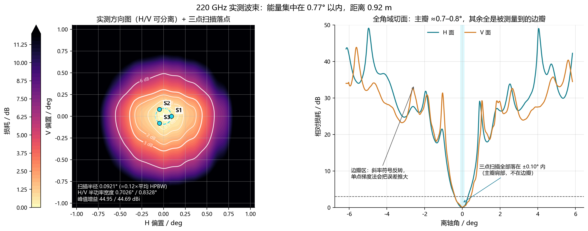
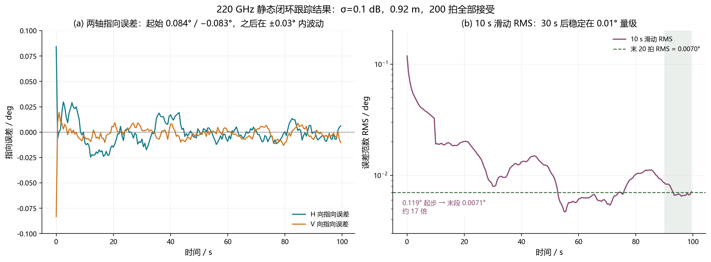
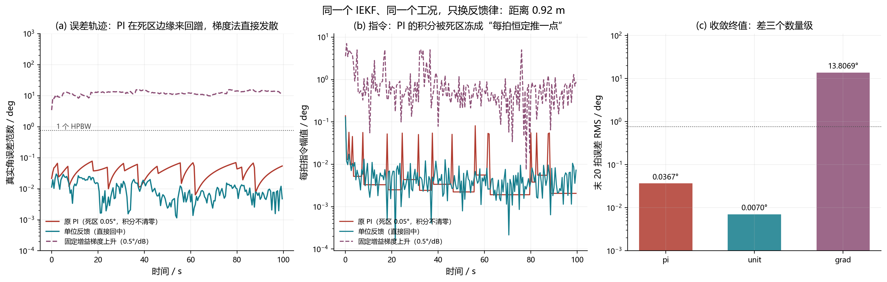

# 220 GHz 太赫兹跟瞄：阶段一至四复现

把 LED 双向主动对准论文（Solanki & Tan, 2022）里的解析高斯光强面，换成 220 GHz 天线的实测方向图，
并按 ITU-R P.676 计入氧气与水汽吸收，在这套信道上验证六状态 IEKF、双向时分和移动跟踪。
阶段一至四包含两条实现线：原有 Python 太赫兹仿真，以及新增的 MATLAB 阶段三四复现。两者参数和单次结果各自独立，文中不交叉引用指标。

## 实现边界

- **Python**：阶段一二链路和静态闭环、阶段三四时分及移动样例。运行方式和对应结果见下文原有章节。
- **MATLAB**：`code/matlab_stage3_4/` 是基于手写 MATLAB 一二阶段滤波框架继续实现的阶段三四独立版本；复用实测方向图和作者归档 MAT 数据，但拥有单独的输出目录及汇报文档。
- MATLAB 动态样例为固定种子单次测试，当前未收敛；不应拿它替换 Python 结果摘要或当作系统性能指标。

## 结果摘要

| 指标 | 0.92 m | 15 m |
| --- | --- | --- |
| 峰值增益 H / V（dBi） | 44.96 / 44.69 | 44.96 / 44.69 |
| 3 dB 波束宽度 H / V（°） | 0.703 / 0.833 | 0.703 / 0.833 |
| 自由空间损耗（dB） | 78.57 | 102.82 |
| 氧气 + 水汽吸收（dB） | 0.0023 | 0.0373 |
| 接收功率（dBm） | 31.07 | 6.79 |
| 信噪比（dB） | 108.0 | 83.7 |

静态闭环（100 s，200 拍，dt = 0.5 s，测量噪声 0.1 dB，随机种子 20261028）：

| 指标 | 数值 |
| --- | --- |
| 初始指向误差范数（回中前） | 0.1185° |
| 单拍终值（回中前） | 0.0120° |
| 单拍终值（回中后） | 0.0047° |
| 末 20 拍 RMS（回中后） | 0.0070° |
| 10 s 滑动 RMS 末值（回中前） | 0.0071° |
| IEKF 测量接受 | 200 / 200 |
| NEES 均值（后 60 拍） | 0.42 |

误差底约为 0.009 个半功率宽度，继续压低要靠更好的测量，而不是更快的回中。
两个距离的角误差逐点相同，差别只在功率基线 q（24.28 dB），原因是这版模型里 0.1 dB 的测量噪声
是标定假设，与热噪声无关——按能量检测器估算，辐射计噪声要到 2.1 km 才达到 0.1 dB。

## 目录结构

```
.
├── code/
│   ├── stage1_2_thz.py                 # 阶段一二入口：方向图、链路预算、静态闭环
│   ├── stage3_4_thz.py                 # 阶段三四入口：双向时分、被动标量、正交移动
│   ├── stage1_2_figures.py             # 报告用图与诊断图（--only 选图）
│   ├── main_THZ_220GHz_deterministic_mechanical_tracking.py   # 220 GHz 建模底层库
│   └── matlab_stage3_4/                 # MATLAB 阶段三四独立实现
├── data/
│   ├── LWB_CRS-220-100MM-2406-2.xlsx   # 实测 H/V 切面，各 601 点
│   ├── author_reference/               # Python 使用的作者归档数据
│   └── author_reference_mat/           # MATLAB 使用的原始 MAT 归档
├── outputs/
│   ├── stage1_2_0.92m/                 # 摘要、逐拍 CSV、原始两图
│   ├── stage1_2_15m/
│   ├── stage3_4/                       # 双向/动态逐拍 CSV、摘要、四张结果图
│   ├── figures/                         # 阶段一二报告插图（fig01/04/06/09）
│   └── matlab_stage3_4/                 # MATLAB 独立结果：CSV 与 figures/
├── docs/
│   ├── 220GHz_THz_stage1_2_report.docx # 阶段一二报告
│   ├── 220GHz_THz_stage3_4_report.docx # 阶段三四报告（四图两表）
│   ├── stage1_2_notes.md
│   ├── stage3_4_notes.md               # Python 阶段三四说明
│   └── matlab_stage3_4/                # MATLAB 技术说明、快照和汇报 Word
├── tools/
│   ├── build_report.py                 # 阶段一二 docx
│   ├── build_stage34_report.py         # 阶段三四 docx
│   └── make_stage34_figures.py         # 半径脉冲、距离/速度对标、正交跟踪
└── requirements.txt
```

MATLAB 子项目的主要入口为 `code/matlab_stage3_4/run_thz_stage3_4.m`，函数文件与入口放在同一目录。

## 环境

Python 3.10 及以上。

```
pip install -r requirements.txt
```

大气衰减用 `itur==0.4.0` 的 P.676-12 逐线实现，版本写在摘要 JSON 里，换版本会改变比衰减。
读取 Excel 需要 `openpyxl`；生成报告需要 `python-docx`。
MATLAB 复现使用 MATLAB R2023a（或兼容 `readtable`、`exportgraphics` 的版本），不依赖 Python 环境；Python 只用于生成 Word 汇报。

## 运行

```
python code/stage1_2_thz.py --distance-m 0.92
python code/stage1_2_thz.py --distance-m 15
python code/stage1_2_figures.py --only f01 f04 f06 f09
python tools/build_report.py          # 可选，重新生成 docs 下的 docx
```

`stage1_2_thz.py` 默认使用单位反馈（`--feedback unit`），得到上表结果。
加 `--feedback pi` 可复现原来的 PI 闭环：终值 0.054°，但那是死区冻住积分形成的极限环，
不是稳态；两者的差别在报告 3.3 节有说明。

阶段三四：

```
python code/stage3_4_thz.py --mode static                  # 160 拍，双向交替 + 冻结断言
python code/stage3_4_thz.py --mode dynamic --speed-factor 0.2   # 200 拍，正交移动
python tools/make_stage34_figures.py                       # 四张结果图
python tools/build_stage34_report.py                       # 阶段三四 docx
```

结果：静态两端末段 RMS 0.0079° / 0.0188°，被动冻结偏差 0（门限 1e-12）；
动态 Rover / Elevator 末端 0.122° / 0.309°，距离 2.3000 → 2.3087 m。
扫描半径不是照搬 LED 的 2°–5°，而是按半功率宽度换成 0.043°–0.084°，
原因见 `docs/stage3_4_notes.md` 第 4 节。

`stage1_2_figures.py` 的图号：
`f01` 二维波束与扫描位置、`f02` 主瓣斜率、`f03` PCHIP 插值检查、`f04` 链路预算、
`f05` IEKF 诊断、`f06` 三种反馈律、`f07` 捕获域网格、`f08` 两距离对比、`f09` 静态闭环结果。
报告只用了 f01、f04、f06、f09；f07 较慢（25×25 网格），需要时单独跑。

## 输出说明

### MATLAB 阶段三四

在 MATLAB R2023a（需支持 `readtable`、`exportgraphics`）中，从仓库根目录运行：

```matlab
run(fullfile('code','matlab_stage3_4','run_thz_stage3_4.m'))
```

入口会执行两种半径策略（论文 2°–5° 和按实测 HPBW 缩放的 THz 半径），包括 160 拍静态时分验证、200 步动态测试及无前馈消融；随后重绘作者 Fig. 8/10 MAT 归档。所有 CSV 写入 `outputs/matlab_stage3_4/`，全部 PNG 写入 `outputs/matlab_stage3_4/figures/`。Passive 受保护状态和协方差项均需通过 `1e-12` 断言。

固定种子动态单次结果（误差单位为度）：论文半径无前馈 Rover/Elevator 为 31.017/22.361，有前馈为 17.031/30.640；THz 半径无前馈为 20.632/19.386，有前馈为 25.794/14.492。四组均未收敛，且前馈对两端、两轴的影响并不一致。静态冻结最大偏差为 0。动态距离为 2.3000→2.3087 m。作者归档曲线属于原论文 LED 系统，不是本地 THz 动态实验。

MATLAB Word 报告可用 Python 生成（依赖 `python-docx`）：

```powershell
python tools/build_matlab_stage34_report.py
```

输出文件为 `docs/matlab_stage3_4/220GHz太赫兹阶段三四融合复现汇报_适中篇幅版.docx`，报告中的图号与 `outputs/matlab_stage3_4/figures/fig01` 至 `fig10` 对应。

`outputs/matlab_stage3_4/figures/legacy/` 仅保存整理前的重复图名，不作为报告主图；主结果固定使用 `fig01`–`fig10`。

`outputs/stage1_2_*/stage1_2_summary.json`：参数、P.676 环境、链路预算、闭环指标、状态顺序。
`stage2_static_iekf_data.csv` 逐拍一行，列的含义：

- `pre_h_error_deg`、`pre_v_error_deg`：本拍回中**前**的指向误差（控制器要消除的量）；
- `true_h_error_deg`、`true_v_error_deg`：回中**后**的残余误差；
- `estimated_*`：滤波器估计；`command_*`：回中指令；
- `innovation_score`、`measurement_scale`：新息检验与 R 膨胀因子；
- `minimum_covariance_eigenvalue`：协方差半正定检查。

报告里的 0.0120° 对应 `pre_*`，0.0047° 与 0.0070° 对应 `true_*`，两者定义不同，引用时注意区分。

## 方法要点

**信道。** 两条切面各 601 点（0.02° 间隔），按各自峰值对齐后计算相对损耗，用 PCHIP 插值。
不用三次样条是因为它在峰值附近会过冲，插出高于实测峰值的增益，改变零点附近的斜率。
二维方向图按 `L(α,ε) = L_H(α) + L_V(ε)` 可分离近似，保留实测切面形状，交叉耦合不可见。
角度超出测量域时损耗夹紧、导数置零，避免外推被当作有效观测。

**大气。** P.676 逐线，氧气 0.015444、水汽 2.471371 dB/km，按距离折算。
15 m 处合计 0.037 dB，保留该项是为了远距离预算口径一致。

**滤波器。** 状态 `x = [q, q_dot, e_H, e_E, ω_H, ω_E]`，预测为常数功率变化率与常数角速率，
量测为异步三点 `z_i = q − q_dot·τ_i + g(e − ω·τ_i − s_i)`。
1×6 雅可比由 PCHIP 导数解析给出，中心差分核验的最大偏差 2.3e-9；协方差用 Joseph 形式，
迭代重线性化 8 次，新息超限时膨胀 R。

**闭环。** 每拍三点扫描，半径固定 0.092°（0.12 倍平均半功率宽度），扫描偏置按 0/120/240° 布置，
样本年龄 0.20/0.10/0.00 s。回中使用单位反馈，并限幅到 1.5 倍半功率宽度。

## 结果图







## 已知限制

- 双向与移动跟踪是独立脚本 `stage3_4_thz.py`，还没有并回主仿真器；主程序 `step()` 里两端
  滤波器每拍都 `predict`，非活跃端没有量测却累积过程噪声，协方差只涨不消。
- 太赫兹侧只做了单次确定性的速度因子 0.2 样例，没有速度扫描和 Monte Carlo；
  距离/速度的曲线来自作者 LED 归档数据，只作趋势对照。
- 测量噪声 0.1 dB 是设定的标定/模型误差，不随距离变化，因此本仓库不能用来讨论测距对精度的影响。
- 可分离近似忽略 H/V 交叉耦合；暗室只给了两条切面，这一点无法从数据上验证。
- 阶段一二的扫描半径按平均 HPBW 统一取，没有按各轴斜率分别选择。V 面在 0.10–0.17° 的
  斜率只有 0.76 dB/deg，这个取法对 V 轴不利。
- 被动期没有 IMU 辅助，4 秒盲区内的姿态变化只能靠冻结硬扛。

## 参考

Solanki, P. K., & Tan, Y. (2022). A Bidirectional Active-Alignment Control System for LED Communication.
（本地复现以 2022 年论文的阶段一二为目标，信道替换为 220 GHz 实测方向图。）
